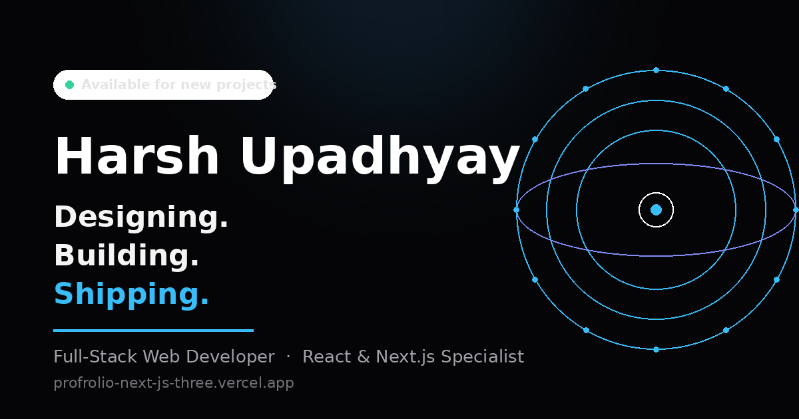
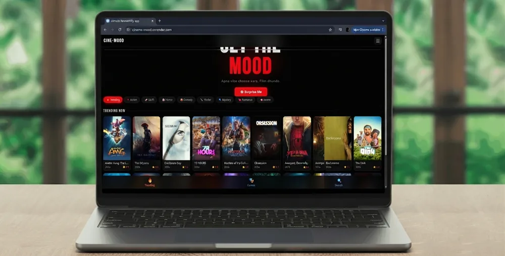
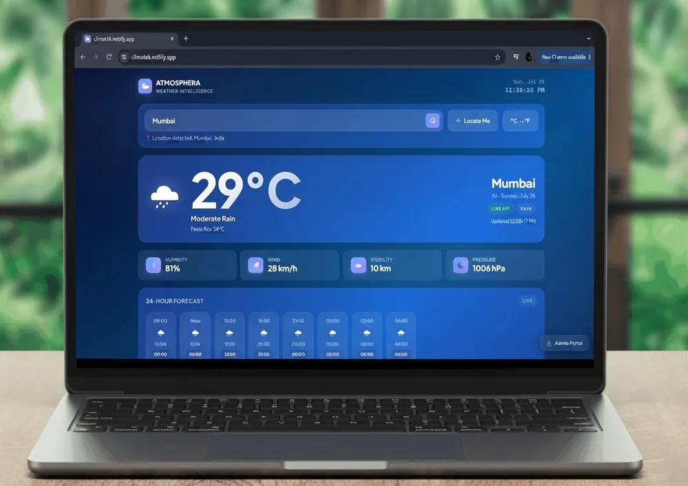

<div align="center">

# Harsh Upadhyay — Premium Developer Portfolio

**Designing. Building. Shipping.**

[](https://profrolio-next-js-three.vercel.app)
[](https://nextjs.org)
[](https://www.typescriptlang.org)
[](https://tailwindcss.com)
[](#-license)

[**🌐 Live Site**](https://profrolio-next-js-three.vercel.app) ·
[**📬 Contact Form (Tally)**](https://tally.so/r/QKpNqX) ·
[**💼 LinkedIn**](https://www.linkedin.com/in/harsh-upadhyay-a014783b4) ·
[**🐙 GitHub**](https://github.com/Dev-Harshupadhyay) ·
[**✈️ Telegram**](https://t.me/TIMEPASSQ_BOT)

<a href="https://profrolio-next-js-three.vercel.app">
  
</a>

</div>

---

## 📣 What's in this commit — the "Solid Upgrade"

The latest push reworks the portfolio end-to-end on top of commit [`e0a6565`](https://github.com/Dev-Harshupadhyay/Profrolio-next-Js-/commit/e0a6565):

| Area | Change |
|---|---|
| 🎞️ **Signature scroll animation** | The Services section now has a serpentine path that draws itself on scroll and lights each capability card in sequence — ported from [pmharshuu.netlify.app](https://pmharshuu.netlify.app), recolored from red to the brand **blue → indigo → purple** gradient |
| 💜 **About, reimagined** | Full-bleed indigo/violet section styled after [the reference build](https://pmharshuu.netlify.app) — Harsh's photo **first** in a hanging frame with a drop-bounce entrance, then the editorial intro, tech logos and glass attribute pills |
| ✉️ **Real contact form** | Fake mailto form replaced with the exact hosted **[Tally form](https://tally.so/r/QKpNqX)** + direct email/copy, LinkedIn, GitHub and Telegram channels |
| 📦 **Projects, synced** | Project imagery swapped to optimized **WebP** (~37 KB vs 1.5 MB PNG), ClimaTek naming/live URL aligned, and the showcase now features **[Timepass Premium](https://verceel-timepass.vercel.app)** (pricing & checkout platform) in place of the old bot card |
| 🧹 **3D removed** | WebGL hero canvas, floating 3D badges, tilt/glare cards and all "3D" copy — gone. Flat, fast, motion-light UI |
| 🔍 **SEO, complete** | Correct canonical domain, favicons + web manifest, 1200×630 `og-cover.png`, JSON-LD `Person` + `WebSite`, dynamic sitemap/robots, themed `noindex` 404 |
| ⚡ **Performance** | Home First Load JS **328 kB → 184 kB**, `profile.jpg` **1.37 MB → 68 KB**, ESLint (`next/core-web-vitals`) passing clean |

---

## 🎞️ Signature scroll animation

As you scroll the **Capabilities** section, the path draws itself in the sky→indigo→violet gradient and each card flips to its lit state the moment the path reaches it — the mechanic borrowed from [pmharshuu.netlify.app](https://pmharshuu.netlify.app), re-skinned to this site's palette.

<div align="center">
  <a href="https://profrolio-next-js-three.vercel.app/#services">
    
  </a>
  <br />
  <sub>Open the <a href="https://profrolio-next-js-three.vercel.app/#services">live Capabilities section</a> and scroll to see it.</sub>
</div>

---

## 🖼️ Selected work — every card links to its live case study

<table>
  <tr>
    <td width="50%">
      <a href="https://profrolio-next-js-three.vercel.app/projects/cinevood">
        
      </a>
      <br />
      <sub><b><a href="https://profrolio-next-js-three.vercel.app/projects/chhath-geet">Chhath Geet</a></b> ·
      <a href="https://profrolio-next-js-three.vercel.app/projects/cinevood"><b>Cinevood</b></a> ·
      <a href="https://profrolio-next-js-three.vercel.app/projects/weather-app"><b>ClimaTek</b></a> ·
      <a href="https://profrolio-next-js-three.vercel.app/projects/timepass-premium"><b>Timepass Premium</b></a> ·
      <a href="https://profrolio-next-js-three.vercel.app/projects/tarazu"><b>Tarazu</b></a> ·
      <a href="https://profrolio-next-js-three.vercel.app/projects/nostalgic"><b>Nostalgic</b></a></sub>
    </td>
    <td width="50%">
      <a href="https://climatek.netlify.app">
        
      </a>
      <br />
      <sub>
        <b>Live apps:</b>
        <a href="https://verceel-timepass.vercel.app">Timepass Premium</a> ·
        <a href="https://chhath-puja-ebon.vercel.app">Chhath Geet</a> ·
        <a href="https://cinenvood.onrender.com">Cinevood</a> ·
        <a href="https://climatek.netlify.app">ClimaTek</a> ·
        <a href="https://tarzau.netlify.app">Tarazu</a> ·
        <a href="https://nostalgic-eight.vercel.app">Nostalgic</a>
      </sub>
    </td>
  </tr>
</table>

<div align="center">
  <a href="https://profrolio-next-js-three.vercel.app/#about">
    
  </a>
  <br />
  <sub><a href="https://profrolio-next-js-three.vercel.app/#about">About Harsh →</a></sub>
</div>

---

## 🛠 Tech stack

- **Framework** — [Next.js 14](https://nextjs.org) (App Router, SSG case studies)
- **Language** — [TypeScript](https://www.typescriptlang.org) (strict)
- **Styling** — [Tailwind CSS](https://tailwindcss.com) with Apple-grade design tokens
- **Motion** — [Framer Motion](https://www.framer.com/motion/) (stagger, layout pills, scroll-driven path)
- **Icons** — [Lucide](https://lucide.dev)
- **Theming** — [next-themes](https://github.com/pacocoursey/next-themes) (dark/light, zero hydration mismatch)
- **Forms** — [Tally](https://tally.so/r/QKpNqX)
- **Deploy** — [Vercel](https://vercel.com) Edge CDN

## 📁 Structure

```
app/
  layout.tsx            # SEO, JSON-LD (Person + WebSite), icons, manifest
  page.tsx              # Single-page orchestrator
  not-found.tsx         # Themed 404 (noindex)
  sitemap.ts / robots.ts
  projects/[slug]/      # Static case-study routes
components/             # Hero, About, Services (scroll animation), Contact…
data/                   # profile, projects, skills, experience, services
public/                 # og-cover, favicons, profile.webp, project WebP
```

## 🚀 Quick start

```bash
git clone https://github.com/Dev-Harshupadhyay/Profrolio-next-Js-.git
cd Profrolio-next-Js-
npm install
npm run dev      # http://localhost:3000
npm run build    # production SSG build
npm run lint     # next lint (clean)
```

## 🙌 Credits & references

- Scroll-activation animation & section layout inspired by [pmharshuu.netlify.app](https://pmharshuu.netlify.app)
- Project imagery & copy synced from [new-profotilo-flame.vercel.app](https://new-profotilo-flame.vercel.app)
- Contact form hosted on [Tally](https://tally.so/r/QKpNqX)
- New project link: [verceel-timepass.vercel.app](https://verceel-timepass.vercel.app)

## 📄 License

Designed & built by [Harsh Upadhyay](https://github.com/Dev-Harshupadhyay).
© 2026 Harsh Upadhyay. All rights reserved.

<div align="center">
  <sub><a href="https://profrolio-next-js-three.vercel.app">profrolio-next-js-three.vercel.app</a> ·
  <a href="#-whats-in-this-commit--the-solid-upgrade">Back to top ↑</a></sub>
</div>
